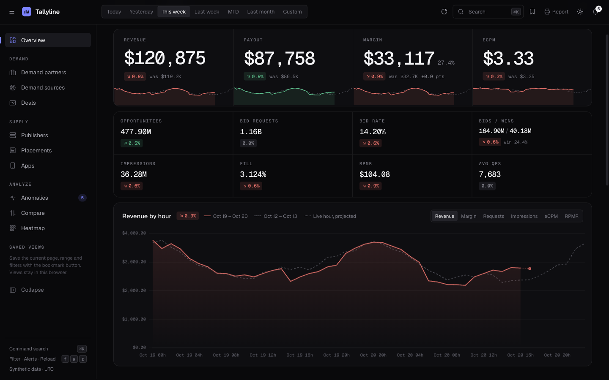
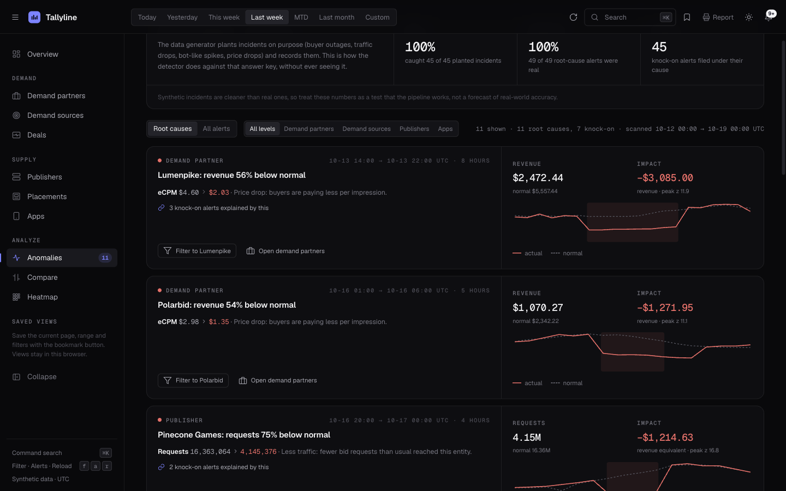
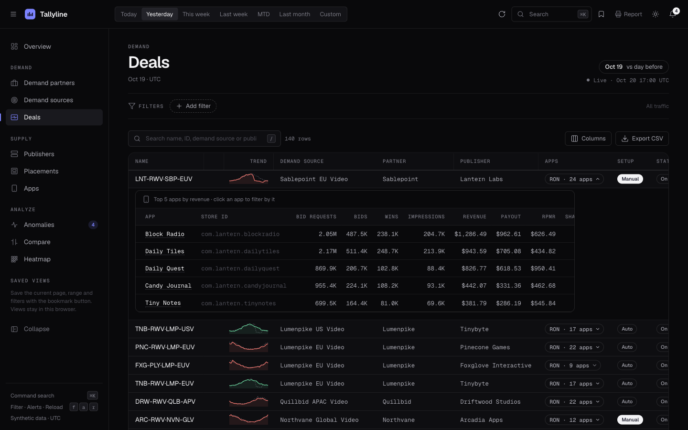
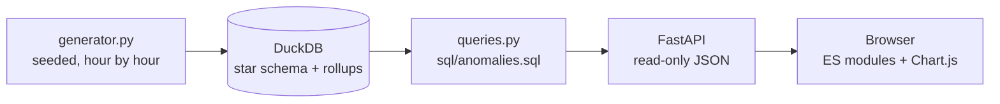

# Tallyline

**An analytics workspace for a programmatic ad exchange: live KPIs, drill-downs across both sides of the marketplace, and anomaly detection that names the likely cause.**

Every number is synthetic. A seeded generator simulates twelve buyers, ten publishers and about 150 deals hour by hour, and plants incidents (outages, traffic drops, bot-like spikes, price cuts) for the detector to find. Nothing here comes from a real company.

**Live demo: [tallyline.onrender.com](https://tallyline.onrender.com)** (free hosting: the first visit after a quiet spell takes 30–60 s to wake up).



## What it does

| | |
|---|---|
| **Overview** | Revenue, payout, margin and eCPM against a fair comparison window, the full funnel (opportunities → bid requests → bids → wins → impressions), a live hourly trend, revenue by format, leaders |
| **Six drill-down levels** | Demand partners → demand sources → deals ← placements ← publishers, plus apps. Click a name to filter and go one level down. Every table sorts, searches, picks columns, exports CSV and shows a sparkline per row |
| **Anomaly detection** | Each hour is compared with the same hour of the week over the previous four weeks, using a robust z-score (median and MAD). Incidents come with the funnel step that moved (*"Bid rate 12.1% → 0.4%: the buyer stopped bidding"*), and knock-on alerts are grouped under their root cause |
| **Compare and heatmap** | Any two entities side by side with an overlaid chart; an hour × day heatmap for spotting patterns |
| **Saved views and report** | Save a page, range and filter set by name. Open any view as a printable one-page report (or save it as a PDF) |
| **Live hour** | The newest hour fills in as the clock moves. It is drawn as a projection and never used in a comparison, so "today so far" is always compared with "yesterday up to the same hour" |

Also: ⌘K command search, keyboard shortcuts, light and dark themes, deep links for every view, and a phone layout.

| Anomalies | Deals |
|---|---|
|  |  |

## Does the detector work?

The generator keeps an answer key of the incidents it planted, and the test suite scores the detector against it without the detector ever seeing it. Results for the last 30 days, across three random seeds:

| Seed | Planted incidents | Caught (recall) | Root-cause alerts | Correct (precision) | Knock-on alerts grouped |
|---|---|---|---|---|---|
| 7 | 45 | 45 (100%) | 49 | 49 (100%) | 45 |
| 11 | 40 | 40 (100%) | 45 | 45 (100%) | 59 |
| 23 | 39 | 39 (100%) | 49 | 46 (94%) | 95 |

Planted incidents are cleaner than real ones, so read this as proof that the pipeline works end to end, not as a promise of real-world accuracy. The method and its trade-offs are in [docs/anomaly-detection.md](docs/anomaly-detection.md).

## How it's built



- **Data:** Python + NumPy generate the marketplace and its traffic: a daily curve per audience region, a weekend lift, growth, noise, QPS caps and planted incidents. Every hour has its own random stream, so history never changes and any machine produces identical data.
- **Warehouse:** DuckDB with a star schema ([sql/schema.sql](sql/schema.sql)). The facts are stored at app grain and rolled up per deal, and each query reads the smallest table that can answer it. Views scale the live hour by the share elapsed.
- **SQL that does the analysis:** the detector is two statements in [sql/anomalies.sql](sql/anomalies.sql): windowed `median`/`mad` over the same hour of the week, then the *gaps and islands* pattern to merge consecutive hours into incidents.
- **API:** FastAPI, all `GET`, with validated parameters bound into SQL (never pasted in). A typical 31-day query takes 5–30 ms.
- **Front end:** no framework and no build step. About 30 small ES modules, Chart.js for the big charts, hand-drawn SVG for sparklines. Every rate (eCPM, fill, win rate) is computed in one place from additive sums, so totals are never an average of averages.
- **Quality:** 31 tests (determinism, funnel invariants, every breakdown reconciling to the total, comparison windows, bad input, detector precision and recall), Ruff, and GitHub Actions CI.

More detail: [architecture](docs/architecture.md) · [metrics and definitions](docs/metrics.md) · [data model and generator](docs/data-model.md) · [decisions](docs/decisions.md).

## Run it

You need Python 3.11+.

```bash
make setup        # creates .venv and installs dependencies
make run          # http://127.0.0.1:8000  (generates ~100 days of data in about 3 s on first start)
make test         # the test suite
```

Without `make`: `python3 -m venv .venv && .venv/bin/pip install -r requirements-dev.txt && .venv/bin/python -m tallyline serve`.

With Docker: `docker build -t tallyline . && docker run --rm -p 8000:8000 tallyline`.

Settings are environment variables: `TALLYLINE_SEED` (a different seed gives a different marketplace), `TALLYLINE_DAYS`, `TALLYLINE_DB`, `PORT`. See [tallyline/config.py](tallyline/config.py).

## Deploy

It runs at [tallyline.onrender.com](https://tallyline.onrender.com). The repo includes a [render.yaml](render.yaml) blueprint for Render's free plan, and every push to `main` redeploys. The steps are in [docs/deploy-render.md](docs/deploy-render.md).

## Project layout

```
tallyline/        Python package: catalog, generator, warehouse, scope, queries, anomalies, links, api
sql/              schema.sql, views.sql, anomalies.sql
web/              index.html, report.html, css/, js/ (pages/, components/)
tests/            pytest suite
docs/             architecture, metrics, data model, anomaly detection, deploy guide, decisions
```

## Credits

Designed and directed by me, built with [Claude Code](https://claude.com/claude-code) as a pair programmer. The idea comes from analytics work on a real ad server; this is an independent rebuild on invented data.

MIT licensed.
